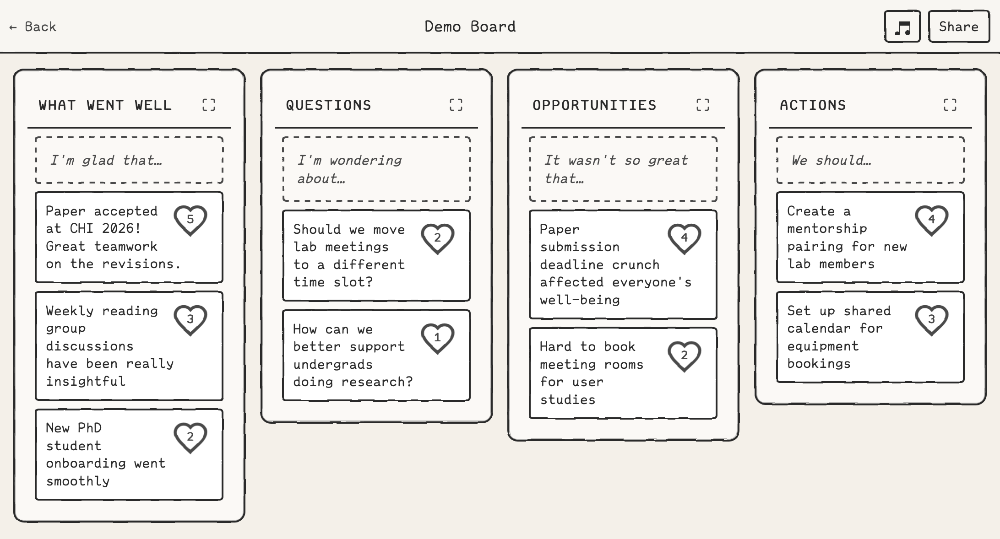

# Retrospective

[](https://github.com/synthetic-society/retrospective/actions/workflows/test.yml)
[](https://opensource.org/licenses/GPL-3.0)


A minimal retrospective board with four columns: **Glad** (what went well), **Wonder** (questions), **Sad** (improvements), and **Action** (follow-ups). Fully anonymous and collaborative: anyone can add, edit, vote, or delete cards. Built with Astro, Preact, Tailwind CSS, and Cloudflare D1.




## Quick Start

Install [Bun 1.3.14](https://bun.com/) and Node.js 22.23.4 or newer, then set up the project:

```bash
bun install --frozen-lockfile
bun run wrangler d1 migrations apply retrospective-db --local
bun run dev
```

## Database Setup

### For Production

Create and configure the D1 database:

```bash
# Create the database
bun run wrangler d1 create retrospective-db

# Copy the database_id from the output and update wrangler.jsonc
# Replace "your-database-id-here" with the actual database_id

# Apply migrations
bun run wrangler d1 migrations apply retrospective-db --remote
```

### For Local Development

For local testing, use a local D1 database:

```bash
# Apply migrations to local database
bun run wrangler d1 migrations apply retrospective-db --local

# Run dev server (automatically uses local D1)
bun run dev

# Run after every changes to wrangler.json to regenerate tests:
bun run types
```

The local D1 database is stored in `.wrangler/state` and doesn't require a database_id in the config.

## Deployment

Build and deploy to Cloudflare Workers:

```bash
# Regenerate Cloudflare types, type-check, and build the application
bun run build

# Deploy to Cloudflare Workers
bun run wrangler deploy
```

The app will be deployed to your Cloudflare Workers subdomain at `https://retrospective.<your-subdomain>.workers.dev`

## Testing

The project uses [Playwright](https://playwright.dev/) for end-to-end testing with accessibility tests by [axe-core](https://github.com/dequelabs/axe-core).

### Running Tests

```bash
# Install the pinned browser once
bun run playwright install --with-deps chromium

# Run all tests (starts dev server automatically)
bun run test

# Run tests with interactive UI only
bun run test:ui

# Run accessibility tests only
bun run test:a11y
```

### Test Reports

After running tests, an HTML report is generated in `playwright-report/`. Open it with:

```bash
bun run playwright show-report
```
